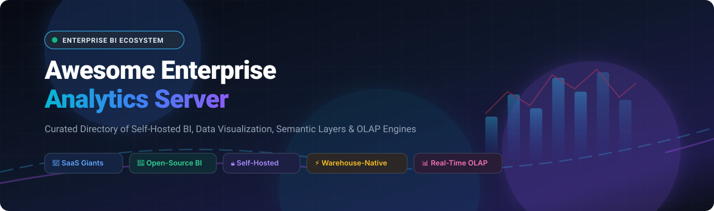
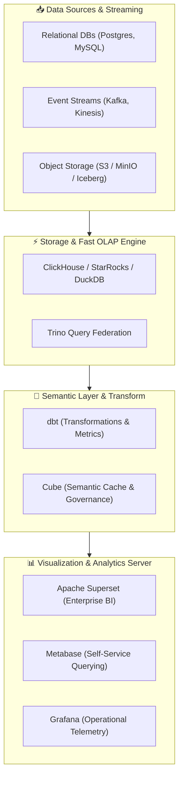

# Awesome Enterprise Analytics Server 🚀

  <strong>A curated directory of SaaS platforms, self-hosted business intelligence (BI), real-time OLAP engines, and warehouse-native enterprise analytics servers.</strong>

  
  
  
  
  
  

---

## 📖 Executive Summary & SEO Overview 🔍

Organizations handling sensitive enterprise data require robust, scalable, and compliant **Enterprise Analytics Servers**. Whether complying with HIPAA, GDPR, SOC2, and data residency mandates or seeking vendor-independent architectures, data teams leverage **self-hosted BI tools**, **warehouse-native analytics platforms**, and **headless semantic layers** to govern reporting and self-service analytics.

This repository tracks top-tier commercial **SaaS / Hosted Platforms** and community-backed **Open-Source GitHub Projects**. It serves as an authoritative guide for data platform engineers, chief data officers (CDOs), analytics engineers, and enterprise software architects.

> **Key Search Keywords**: *Enterprise Analytics Server, Self-Hosted BI, Open Source Business Intelligence, Warehouse-Native Analytics, Tableau Alternatives, Power BI Report Server Alternatives, On-Premises BI Dashboard, Apache Superset, Metabase, Semantic Layer, Real-time OLAP, ClickHouse, DuckDB.*

---

## 📑 Table of Contents 📌

- [📊 Sector Overview & Market Dynamics](#-sector-overview--market-dynamics)
- [🏢 Enterprise SaaS & Hosted Platforms](#-enterprise-saas--hosted-platforms)
  - [SaaS Comparison Table (Ranked by Company Valuation)](#saas-comparison-table-ranked-by-company-valuation)
  - [In-Depth SaaS Platform Profiles](#in-depth-saas-platform-profiles)
- [🚀 Open-Source GitHub Projects](#-open-source-github-projects)
  - [Open-Source Solutions Ranked by GitHub_Stars](#open-source-solutions-ranked-by-github-stars)
  - [Self-Hosted BI & Visualization Platforms](#self-hosted-bi--visualization-platforms)
  - [Product & Web Analytics Servers](#product--web-analytics-servers)
  - [Headless Semantic Layers & Analytics Middleware](#headless-semantic-layers--analytics-middleware)
  - [High-Performance OLAP Engines & Query Fabric](#high-performance-olap-engines--query-fabric)
- [🏗️ Recommended Architecture Blueprint](#️-recommended-architecture-blueprint)
- [🤝 How to Contribute](#-how-to-contribute)
- [⚖️ Disclaimer & Compliance](#️-disclaimer--compliance)
- [##  Star History](#--star-history)
- [💖 Support & Community](#-support--community)

---

## 📊 Sector Overview & Market Dynamics 🌐

The global Enterprise Business Intelligence and Analytics software market is estimated at **$34.8 billion to $43.7 billion** in 2025–2026, expanding at a Compound Annual Growth Rate (CAGR) of **8.5% to 11.2%** and projected to exceed **$65 billion by 2030**. 

Rather than coalescing into a single "winner-take-all" monopoly, the enterprise analytics sector remains **moderately to highly fragmented** across three coexisting tiers:
1. **Hyperscaler Platforms** (Microsoft Power BI, Google Looker) commanding broad enterprise adoption through cloud software bundling;
2. **Specialized Enterprise Analytics Servers** (Tableau, SAP, Qlik, SAS, MicroStrategy, Sisense) catering to complex governed multi-cloud and on-premises compliance workloads;
3. **Warehouse-Native & Open-Source Modern Stacks** (Superset, Metabase, Cube, ClickHouse, DuckDB) rapidly winning engineering and data teams who demand decoupled compute/storage, git-governed semantic layers, and zero vendor lock-in.

---

## 🏢 Enterprise SaaS & Hosted Platforms 💼

### SaaS Comparison Table (Ranked by Company Valuation)

Below is an overview of the industry-leading commercial and hosted enterprise analytics server platforms, sorted in descending order by company valuation / market capitalization:

| Platform & Vendor | Company Size (Valuation / Revenue) 📈 | Starting Tier Pricing 💵 | Free Tier / Free Trial Limits ⏱️ | Deployment Architecture ⚙️ |
| :--- | :--- | :--- | :--- | :--- |
| **[Microsoft Power BI Report Server](https://powerbi.microsoft.com/report-server/)** | ~$3.1 Trillion *(Market Cap)* | **$10.00** / user / month *(Power BI Pro)* | **Free forever** via Power BI Desktop (local authoring & offline report generation); **60-day free trial** for Power BI Pro/Fabric with 10 GB cloud storage & collaboration | On-Premises (SQL Server Enterprise + SA), Hybrid & Azure Cloud |
| **[Looker Hosted](https://looker.com/)** | ~$2.1 Trillion *(Alphabet / Google)* | **$9.00** / user / month *(Looker Studio Pro)* or **$5,000.00** / month *(Looker Core Standard)* | **Free forever** on Looker Studio (unlimited dashboards & viewers); **30-day free trial** for Looker Studio Pro; **30-day guided Proof of Concept (POC)** for Looker Core | Google Cloud Platform (GCP) Hosted & Multi-Cloud |
| **[SAP BusinessObjects](https://www.sap.com/)** | ~$260 Billion *(Market Cap)* | **$36.00** / user / month *(SAP Analytics Cloud)* or **~$100.00** / user / month equiv. *(BO On-Prem)* | **30-day free trial** for SAP Analytics Cloud (shared tenant, pre-loaded sample datasets, up to 10 users); SAP Cloud Appliance Library trial image for BO server | On-Premises (Windows/Linux) & SAP Private Cloud |
| **[Salesforce Tableau Server](https://www.tableau.com/products/server)** | ~$250 Billion+ *(Salesforce, Inc.)* | **$15.00** / user / month *(Viewer)*; **$75.00** / user / month *(Creator, required base)* | **Free forever** via Tableau Public (unlimited public workbooks, up to 10 GB storage, public data only); **14-day free trial** for Tableau Server / Cloud Creator | Self-Hosted On-Premises (Windows / Linux), AWS, Azure, GCP |
| **[Cognos Analytics](https://www.ibm.com/products/cognos-analytics)** | ~$210 Billion *(IBM Corporation)* | **$10.60** / user / month *(Standard Cloud)*; **$42.40** / user / month *(Premium)* | **30-day free trial** for up to 5 Premium users including AI Assistant, dashboarding, and natural language data modeling | IBM Cloud SaaS & Self-Hosted On-Premises Containerized |
| **[MicroStrategy Enterprise / ONE](https://www.microstrategy.com/)** | ~$70 Billion *(Market Cap)* | **$13.00** / user / month *(Standard)*; **~$600.00** / user / month *(Professional Author)* | **30-day guided Proof of Concept (POC)** coordinated via sales engineering (no self-serve free-forever tier) | Self-Hosted Linux/Windows, AWS, Azure & Managed Cloud |
| **[Tibco Spotfire Server](https://www.spotfire.com/)** | ~$16.5 Billion *(Cloud Software Group)* | **$25.00** / user / month *(Consumer)*; **$65.00** / user / month *(Business Author)* | **30-day free trial** for Spotfire Cloud / Industry Pro with full streaming data connectivity and visual data science extensions | Self-Hosted Server (Windows / Linux) & Spotfire Cloud |
| **[SAS Visual Analytics](https://www.sas.com/en_us/software/visual-analytics.html)** | ~$16.0 Billion *(Valuation / ~$3.2B Rev)* | **$700.00** / month *(Hosted starter cloud bundle)* or **~$8,000.00** / month enterprise tier | **14-day free trial** for SAS Viya cloud sandbox with full SAS Visual Analytics, machine learning, and automated exploration features | Self-Hosted Kubernetes (Viya) & SAS Cloud Managed |
| **[Qlik Sense Enterprise](https://www.qlik.com/us/products/qlik-sense)** | ~$10.0 Billion *(Thoma Bravo Valuation)* | **$300.00** / month *(Starter tier: 10 users, 10 GB)*; **$825.00** / month *(Standard: 25 GB)* | **30-day free trial** for Qlik Cloud Analytics with complete Associative QIX engine access and no credit card required | Multi-Cloud Kubernetes, Windows Server & Qlik Cloud |
| **[Sisense Linux](https://www.sisense.com/)** | ~$1.0 Billion *(Valuation / ~$150M ARR)* | **$2,083.00** / month *(~$25,000 / year base enterprise subscription)* | **7-day free trial** (interactive test drive with sample datasets, custom connections, and embedded SDK widgets; no credit card required) | Self-Hosted Linux (Kubernetes / Single-Node) & Sisense Cloud |

---

### In-Depth SaaS Platform Profiles 📝

- 🔹 **[Microsoft Power BI Report Server](https://powerbi.microsoft.com/report-server/)**  
  On-premises enterprise analytics solution for organizations requiring strict data residency within their corporate data center. Included with SQL Server Enterprise Edition plus Software Assurance or Power BI Premium capacity. Delivers paginated reports, interactive KPI dashboards, and DAX analytical models. Data Gateway integration allows secure data refresh without migrating confidential databases to public clouds.

- 🔹 **[Looker Hosted (Google Cloud)](https://looker.com/)**  
  Enterprise semantic layer and business intelligence suite built around LookML (a code-based modeling language). Features Git version control, embedded analytics, and warehouse-native SQL compilation. All transformation logic compiles dynamically to push query compute directly into BigQuery, Snowflake, Databricks, or Redshift.

- 🔹 **[SAP BusinessObjects (BOBJ)](https://www.sap.com/)**  
  Flagship on-premises enterprise reporting suite designed for Global 2000 enterprises deeply invested in SAP HANA, SAP BW, and ERP systems. Features Web Intelligence (WebI), Crystal Reports for pixel-perfect paginated documentation, and granular role-based authorization matrices.

- 🔹 **[Salesforce Tableau Server](https://www.tableau.com/products/server)**  
  Industry gold standard for exploratory data visualization and self-service dashboarding. Tableau Server offers complete operational control over host hardware, network isolation, and identity governance (SAML/SCIM/Active Directory). Powered by the Hyper in-memory data engine for low-latency visual analytics.

- 🔹 **[IBM Cognos Analytics](https://www.ibm.com/products/cognos-analytics)**  
  Governed enterprise BI platform with integrated conversational AI. Delivers automated data preparation, scheduled report bursting, and natural language storytelling. Deploys on-premises via containers or through IBM Cloud On-Demand.

- 🔹 **[MicroStrategy Enterprise / ONE](https://www.microstrategy.com/)**  
  Enterprise-grade analytics engine known for high scalability, federated metadata schema, and zero-click "HyperIntelligence" cards that inject contextual real-time analytics into web browsers, Microsoft Office, and mobile apps.

- 🔹 **[Tibco Spotfire Server](https://www.spotfire.com/)**  
  High-performance analytics server specialized for interactive visualization, operational telemetry, and predictive modeling. Features in-memory computing, native execution of R and Python scripts, and real-time Kafka/IoT streaming analytics.

- 🔹 **[SAS Visual Analytics](https://www.sas.com/en_us/software/visual-analytics.html)**  
  High-powered visual data discovery platform built atop the SAS Viya microservices architecture. Empowers business analysts and statisticians with automated machine learning, predictive forecasting, and interactive reporting on petabyte-scale data lakes.

- 🔹 **[Qlik Sense Enterprise](https://www.qlik.com/us/products/qlik-sense)**  
  Powered by the patented QIX Associative Engine, allowing users to explore non-linear data relationships without predefined query hierarchies. Deploys seamlessly on-premises on Windows or Linux Kubernetes clusters, as well as multi-cloud environments.

- 🔹 **[Sisense Linux](https://www.sisense.com/)**  
  Containerized Linux BI platform specialized for OEM embedded analytics and customer-facing data products. Features ElastiCube for in-memory data modeling, composable UI React SDKs, and Git-integrated CI/CD dashboard delivery.

---

## 🚀 Open-Source GitHub Projects 🌟

### Open-Source Solutions Ranked by GitHub_Stars

The table below lists all curated open-source projects for self-hosted business intelligence, semantic layers, and real-time OLAP servers, **sorted strictly in descending order by GitHub_Stars**. Each Stars_Badge links directly to the respective repository's stargazers page:

| Rank | Project & Repository | Stars_Count Badge | Primary Category | License | Core Tech Stack |
| :---: | :--- | :---: | :--- | :--- | :--- |
| 1 | **[Grafana](https://github.com/grafana/grafana)** |  | Observability & BI Dashboards | AGPL-3.0 | Go, TypeScript, React |
| 2 | **[Apache Superset](https://github.com/apache/superset)** |  | Self-Hosted Enterprise BI | Apache-2.0 | Python, React, Flask, SQLAlchemy |
| 3 | **[ClickHouse](https://github.com/ClickHouse/ClickHouse)** |  | Columnar OLAP Engine | Apache-2.0 | C++ |
| 4 | **[Metabase](https://github.com/metabase/metabase)** |  | Self-Service BI & Visual Querying | AGPL-3.0 | Clojure, React, JVM |
| 5 | **[DuckDB](https://github.com/duckdb/duckdb)** |  | In-Process Analytical Engine | MIT | C++ |
| 6 | **[PostHog](https://github.com/PostHog/posthog)** |  | Product Analytics Server | MIT / PostHog Comm. | Python, TypeScript, ClickHouse |
| 7 | **[Umami](https://github.com/umami-software/umami)** |  | Privacy-Focused Web Analytics | MIT | Next.js, TypeScript, PostgreSQL |
| 8 | **[Plausible Analytics](https://github.com/plausible/analytics)** |  | Lightweight Analytics Server | AGPL-3.0 | Elixir, Phoenix, ClickHouse |
| 9 | **[Redash](https://github.com/getredash/redash)** |  | SQL-Native Visualization | BSD-2-Clause | Python, React, PostgreSQL |
| 10 | **[DataEase](https://github.com/dataease/dataease)** |  | No-Code BI & Reporting Server | GPL-3.0 | Java, Spring Boot, Vue.js |
| 11 | **[Cube](https://github.com/cube-js/cube)** |  | Headless Universal Semantic Layer | Apache-2.0 | Rust, TypeScript |
| 12 | **[Apache Doris](https://github.com/apache/doris)** |  | Real-Time MPP Analytical DB | Apache-2.0 | C++, Java |
| 13 | **[Apache Druid](https://github.com/apache/druid)** |  | Real-Time Streaming Analytics DB | Apache-2.0 | Java |
| 14 | **[Trino](https://github.com/trinodb/trino)** |  | Distributed SQL Query Engine | Apache-2.0 | Java |
| 15 | **[StarRocks](https://github.com/StarRocks/starrocks)** |  | Sub-Second Vectorized OLAP | Apache-2.0 | C++, Java |
| 16 | **[Evidence](https://github.com/evidence-dev/evidence)** |  | Code-Based Markdown BI | MIT | Svelte, Node.js, DuckDB |
| 17 | **[Apache Zeppelin](https://github.com/apache/zeppelin)** |  | Collaborative Data Notebook | Apache-2.0 | Java, Scala, Python |
| 18 | **[Lightdash](https://github.com/lightdash/lightdash)** |  | dbt-Native Warehouse BI | MIT | TypeScript, Node.js, React |
| 19 | **[Apache Pinot](https://github.com/apache/pinot)** |  | Real-Time Distributed OLAP | Apache-2.0 | Java |
| 20 | **[Rill](https://github.com/rilldata/rill)** |  | Fast Operational Dashboards | Apache-2.0 | Go, Svelte, DuckDB |
| 21 | **[Knowage Server](https://github.com/KnowageLabs/Knowage-Server)** |  | Enterprise Open BI Suite | AGPL-3.0 | Java, Angular |

---

### Self-Hosted BI & Visualization Platforms 📊

- 🔸 **[Grafana](https://github.com/grafana/grafana)**   
  Leading open observability and dashboarding engine. While born in infrastructure metrics, modern Grafana features robust SQL query editors for PostgreSQL, MySQL, ClickHouse, BigQuery, and Snowflake, making it widely deployed for operational BI and executive status displays.

- 🔸 **[Apache Superset](https://github.com/apache/superset)**   
  Top-level Apache Foundation enterprise BI web platform originally engineered at Airbnb. Highlights include a code-free chart builder, deep SQL Lab with autocompletion, lightweight semantic layer, 40+ visualization plugins, and native connectors for 50+ relational/NoSQL backends. Supports row-level security (RLS), dbt model exposures, and guest-token embedded analytics.

- 🔸 **[Metabase](https://github.com/metabase/metabase)**   
  Renowned for exceptional user experience and non-technical accessibility. Features a visual Query Builder, automated dashboard generation (X-Rays), email/Slack alerting, and granular data sandboxing. Deploys via a single JVM container and PostgreSQL database.

- 🔸 **[Redash](https://github.com/getredash/redash)**   
  SQL-first visualization and query collaboration tool. Allows data teams to write raw SQL, visualize query outputs, set automated cron-based data refreshes, and expose live JSON endpoints via REST APIs.

- 🔸 **[DataEase](https://github.com/dataease/dataease)**   
  Open-source data visualization tool featuring intuitive drag-and-drop report composition. Connects to standard relational engines, OLAP stores, and spreadsheets for zero-code enterprise reporting.

- 🔸 **[Evidence](https://github.com/evidence-dev/evidence)**   
  "BI as Code" framework that turns Markdown files with embedded SQL blocks into fast, interactive data websites. Compiles to static sites using DuckDB-Wasm for client-side analytical querying.

- 🔸 **[Lightdash](https://github.com/lightdash/lightdash)**   
  The native BI frontend for dbt users. Reads your dbt schema files directly as its semantic layer, preventing dual-maintenance of metric logic and compiling queries directly into cloud data warehouses.

- 🔸 **[Rill](https://github.com/rilldata/rill)**   
  Fast operational BI tool combining embedded DuckDB and ClickHouse engines. Automatically profiles data schemas, discovers timeseries trends, and renders sub-second dashboards directly from SQL files.

- 🔸 **[Knowage Server](https://github.com/KnowageLabs/Knowage-Server)**   
  Complete modular enterprise open-source BI suite built by Engineering Group. Modules span pixel-perfect Enterprise Reporting, Smart Intelligence self-service, Location GIS Intelligence, and R/Python integration.

---

### Product & Web Analytics Servers 📈

- 🔸 **[PostHog](https://github.com/PostHog/posthog)**   
  All-in-one product analytics suite deployable on private infrastructure. Backed by ClickHouse for real-time funnel calculation, session recording, feature flags, A/B testing, and user cohort analysis.

- 🔸 **[Umami](https://github.com/umami-software/umami)**   
  Privacy-respecting, lightweight web analytics server with zero cookie requirements. Built on Next.js and Prisma, providing clean API integration and dashboard views.

- 🔸 **[Plausible Analytics](https://github.com/plausible/analytics)**   
  Lightweight and privacy-friendly alternative to Google Analytics. Features an Elixir and ClickHouse backend capable of processing millions of event streams with minimal server footprints.

---

### Headless Semantic Layers & Analytics Middleware 🧩

- 🔸 **[Cube](https://github.com/cube-js/cube)**   
  Universal semantic layer for building enterprise data applications. Provides centralized metric definitions, automated pre-aggregations, access control, and a SQL API for connecting downstream BI tools (Superset, Tableau, Power BI) without duplicated definitions.

- 🔸 **[Apache Zeppelin](https://github.com/apache/zeppelin)**   
  Web-based notebook for interactive data analytics, exploratory querying, and collaborative documentation supporting Apache Spark, Python, SQL, and Scala backends.

---

### High-Performance OLAP Engines & Query Fabric ⚡

- 🔸 **[ClickHouse](https://github.com/ClickHouse/ClickHouse)**   
  Ultra-fast open-source columnar database management system for real-time analytical reporting. Generates sub-second responses over trillions of records and powers many modern analytics frontends.

- 🔸 **[DuckDB](https://github.com/duckdb/duckdb)**   
  High-performance in-process vectorized SQL OLAP engine. Acts as the "SQLite for analytics", querying Parquet, CSV, Arrow, and Iceberg tables with zero external dependencies.

- 🔸 **[Apache Doris](https://github.com/apache/doris)**   
  Massively parallel processing (MPP) analytical database compatible with MySQL wire protocol. Delivers real-time stream ingestion, materialized rollups, and sub-second interactive ad-hoc querying.

- 🔸 **[Apache Druid](https://github.com/apache/druid)**   
  Distributed real-time analytical database optimized for low-latency streaming and batch events, event-driven applications, and slice-and-dice timeseries dashboards.

- 🔸 **[Trino](https://github.com/trinodb/trino)**   
  Distributed SQL query engine for federated queries across object stores (S3, GCS, Azure Blob, MinIO), relational databases, and data lakehouses using Apache Iceberg, Delta Lake, or Hive.

- 🔸 **[StarRocks](https://github.com/StarRocks/starrocks)**   
  Next-generation sub-second OLAP engine with fully vectorized execution, cost-based optimizer (CBO), and real-time materialized views across cloud data lakes.

- 🔸 **[Apache Pinot](https://github.com/apache/pinot)**   
  Real-time distributed OLAP datastore designed by LinkedIn and Uber to answer high-throughput analytical queries with millisecond latency for user-facing applications.

---

## 🏗️ Recommended Architecture Blueprint 🛠️

To deploy a self-hosted, enterprise-grade analytics server platform with zero commercial licensing costs, organizations frequently deploy this modular stack:

---

## 🤝 How to Contribute 💡

Contributions are warmly welcomed! Help keep this directory accurate, comprehensive, and up-to-date:

1. 🍴 **Fork the repository** on GitHub.
2. 🌿 **Create a feature branch** (`git checkout -b feature/add-analytics-tool`).
3. 📝 **Add or update entries** in `README.md`:
   - Follow the established tabular format for SaaS tools (including specific starting pricing, free tier limits, and company valuation).
   - For Open-Source additions, include the official repository link, Stars_Count badge (`style=social&color=white` linking to the stargazers page), and license.
4. 🧪 **Ensure all links are live and factual**.
5. 🚀 **Submit a Pull Request** with a concise description of your additions.

---

## ⚖️ Disclaimer & Compliance 🛡️

- **Community Curated**: This repository is a community-driven catalog for research and evaluation purposes; inclusion does not imply official commercial endorsement.
- **Data Compliance**: Operating an Enterprise Analytics Server with confidential customer or employee data requires strict adherence to international regulations, including **GDPR**, **CCPA**, **HIPAA**, and **SOC 2 Type II**.
- **Self-Hosting Maintenance**: Running on-premises analytics stacks entails ongoing operational commitments. Always monitor security bulletins, test metadata database backups regularly, and secure network access via VPC peering, reverse proxies, and SSO/MFA authentication.

---

##  Star History

---

## 💖 Support & Community ☕

Thank you for exploring and utilizing **Awesome Enterprise Analytics Server**! 

If this curated directory has helped your organization, data team, or architecture research, please consider supporting the project:

- ⭐ **Star this repository** to improve visibility across the open-source data community.
- 🍴 **Fork and share** with colleagues, platform engineers, and analytics communities.
- 💬 **Join our discussions** and contribute improvements via PRs.
- ☕ **Sponsor the Author**: If you'd like to support continued maintenance, updates, and curation, please consider buying a coffee via the [GitHub Sponsor Dashboard](https://github.com/sponsors/ishandutta2007).

  

